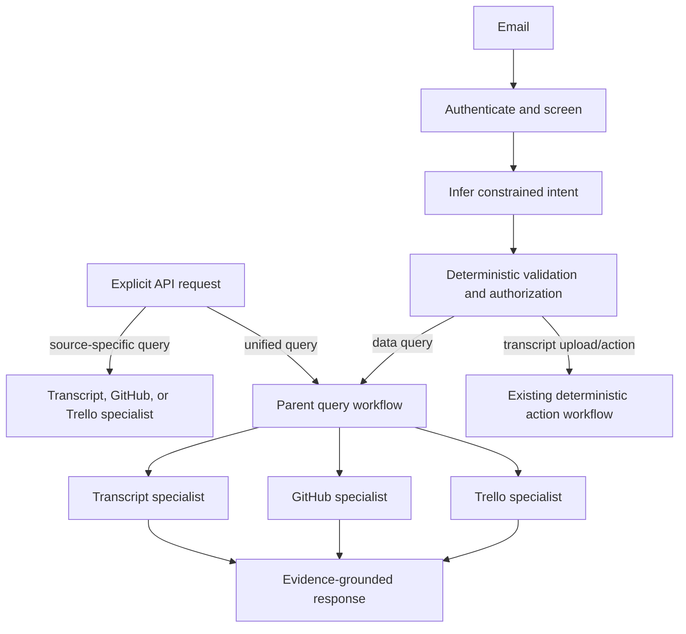

# NLP Agent Architecture Roadmap

This is the single implementation roadmap for natural-language query agents. It distinguishes
the current source-specialist implementation from the remaining parent/email workflow. CRUD and
existing transcript-submission actions remain explicit API/application workflows, not query-agent
tools.

## Agreed Design

- API routes already identify the requested operation. CRUD endpoints continue to call their
  explicit handlers; query endpoints select the source-specific query component without
  re-inferring the request.
- Email requires intent interpretation after sender authentication and message screening. A
  constrained parser distinguishes supported actions (including transcript submission) from
  data queries. Deterministic validation remains the gate before execution.
- There will be three specialist query agents: **transcripts/conversation**, **GitHub**, and
  **Trello**. Each is read-only and returns an answer with inspectable evidence and source
  metadata.
- API source-specific query routes invoke the matching specialist. The unified API route and
  email-query path use a **parent query agent** to select and orchestrate relevant specialists,
  combine their evidence, and handle partial source failures.
- The email parent runs only after the authenticated sender, authorized group, and validated
  intent are bound by application code. Agents never choose credentials, arbitrary URLs, group
  permissions, or CRUD operations. Data access stays scoped and authorized in the backend.
- LangChain provides specialist query/tool and model composition where useful. LangGraph
  coordinates multi-step parent workflows, routing, evidence aggregation, and resumable follow-up
  state. Simple deterministic actions need not be wrapped in agents.

## Current Baseline

- `backend/routes/queries.py` exposes conversation, GitHub, Trello, and unified query routes.
- `backend/engine/query_graph.py` is the parent LangGraph workflow for unified API queries. It
  selects linked/requested sources, invokes the matching read-only specialist with application-bound
  user/group scope, retains per-source errors, and composes multi-source evidence. The email
  `assess_query` handler calls this parent once with validated per-source questions; see Phase 4.
- The email agent parses a constrained command and validates it. After sender authentication and
  deterministic group matching, `assess_query` sends one unified request with per-source focus
  questions through its `DiarisationClient`; the backend parent owns source delegation.
- Transcript upload and transcription already have deterministic processing paths. Provided and
  generated VTTs are chunked and indexed into persistent Chroma. Conversation queries now expose
  persisted speaker statistics as structured data alongside transcript evidence; see the
  [retrieval implementation guide](langchain-langgraph-storage-retrieval.md).
- Weekly reports already use a backend LangGraph and persist report evidence. Their flow is
  separate from conversational query-agent state.
- Transcript, GitHub, and Trello specialists each expose one fixed-scope, read-only retrieval tool.
  The unified API and validated email query flow use a parent specialist workflow.

## Implementation Phases

### 1. Define contracts and evaluation baseline

Initial Phase 1 artifacts: the additive Pydantic contract in
[`backend/engine/query_agent_schemas.py`](../backend/engine/query_agent_schemas.py) and the starter
case set, validated synthetic dataset, and reproducibility protocol in
[Query Agent Contracts And Evaluation](query-agent-evaluation.md) and
[`backend/tests/fixtures/query_agent_synthetic`](../backend/tests/fixtures/query_agent_synthetic/manifest.json).
An initial live API answer/evidence capture now exists at
[`baseline_outputs.json`](../backend/tests/fixtures/query_agent_synthetic/baseline_outputs.json).
The post-fix capture is at
[`after_scope_stats_fixes.json`](../backend/tests/fixtures/query_agent_synthetic/after_scope_stats_fixes.json).
The current-parent capture is
[`current_parent_reviewed.json`](../backend/tests/fixtures/query_agent_synthetic/current_parent_reviewed.json),
recorded on 2026-10-13 with `llama3.1:8b`. All four numeric comparisons pass; the cross-source case
returns its expected sources and stable evidence IDs; and a live partial-source case preserves
available findings while naming the unavailable source. Multi-source parent output now uses
deterministic source sections rather than a final LLM rewrite. The capture is clean at revision
`842ac4e23e205bf5f35a16b1a8dddc294e2b3447`. Offline trust-boundary tests pass; live email intent
was intentionally excluded. Semantic retrieval and performance remain separate evaluation work.
See the [evaluation note](query-agent-evaluation.md).

- Specify common specialist input/output schemas: authorized group context, question, source
  filters, answer, quantitative facts, evidence IDs/metadata, errors, and model/retrieval metadata.
  Quantitative facts must retain their scope, units, provenance, and completeness so the parent can
  combine them with qualitative evidence without estimating counts from retrieved chunks.
- Keep identity, authorization, and group scope outside model-controlled arguments. Define a
  read-only allowlist for each specialist; do not register create/update/delete operations.
- Build a representative evaluation set covering single-source, cross-source, ambiguous,
  unsupported, empty-evidence, unavailable-source, and mixed qualitative/quantitative questions.
  Include transcript speaker-duration/word/turn questions and project activity counts. Capture
  current answers and evidence as a baseline.
- Pin/record model, embedding, framework, prompt, chunking, and retrieval configuration needed
  to reproduce results.

**Exit gate status:** contracts, threat boundaries, synthetic fixture truth, the pre-parent baseline,
and an asserted clean current-parent synthetic evaluation are recorded. Run separate
semantic-retrieval coverage expansion and production-scale performance evaluation before the
academic gate. The nine-query synthetic check returns Recall@8 = 1.0 and MRR@8 = 0.726; one gold
result ranks fifth. Warm local query latency was 12 ms p50 / 13 ms p95; resource use is unmeasured.

### 2. Implement the three specialist query agents

Current implementation: the three typed specialists are wired to the synchronous source-query
routes and their background-job handlers. Transcript retrieval uses the existing retrieve-only
path; GitHub/Trello use the shared retrieval-only project query plus deterministic SQL facts. The
unified route delegates through the parent LangGraph described in Phase 3.

- Implement transcript, GitHub, and Trello specialists behind shared typed contracts.
- Define each specialist's LangChain tools here: narrow, typed, read-only wrappers around its
  existing retrieval/query service. These tools give the specialist agent the ability to inspect
  its source; they are not CRUD endpoints and are not exposed directly to email users.
- Expose the conversation response's existing `transcript_stats` as a read-only specialist tool.
  The API now loads persisted stats with authorized group/meeting/date scope for speaker duration,
  share of meeting time, word count, and turn count; never ask the model to count retrieved chunks.
- Reuse current backend retrieval: transcript Chroma and bounded complete-window reads; project
  Chroma plus Postgres facts/complete-window reads. Preserve GitHub/Trello aggregates from SQL as
  structured specialist output as well as prompt context.
- Bind the authenticated principal and authorized group in application context, not tool arguments
  generated by the model. Give each specialist only its own source's capabilities. Return
  citations/evidence rather than hiding retrieved context inside generated prose.
- Keep existing API response shapes stable while routing each source endpoint through its
  specialist.

**Exit gate status:** offline API/specialist tests cover authorization, evidence contracts, source
scope, and the read-only allowlist. The synthetic live capture verifies numeric facts and evidence
for the current specialists using complete-window retrieval. A separate nine-query synthetic test
exercises actual Chroma ranking across both fixture meetings; broader ranking quality remains
unverified.

### 3. Add the parent query agent

Current implementation: the unified API route and background query jobs now use a parent LangGraph
that delegates to transcript, GitHub, and Trello specialists, aggregates partial failures, and
composes a source-attributed response from answers, deterministic facts, and cited evidence. It
retains specialist facts internally for composition while preserving the public source-response
schema.

- Keep parent delegation limited to the three source specialists (transcripts, GitHub, Trello).
  The parent does not receive CRUD tools or lower-level unrestricted API access.
- Keep API intent explicit in the route/request rather than inferred from arbitrary API calls.
- Record selected sources, specialist inputs/outputs, evidence, failures, and final composition
  for audit and evaluation.

**Exit gate status:** offline and live synthetic checks verify source selection, source-labeled
answers, stable evidence IDs, exact numeric facts, and partial/total source failure handling. The
parent assembles specialist responses deterministically to prevent a second model pass from
rewriting quantitative facts. The current-parent synthetic capture is clean at the recorded
revision; broad semantic retrieval and performance are not covered by that gate.

### 4. Route validated email queries through the parent

Current implementation: the email job worker now makes one unified backend call with validated
per-source focus questions after resolving the sender's authorized group. The backend parent
delegates to selected specialists; the email handler remains the job, cancellation, and reply
delivery boundary.

- Preserve the email trust boundary: authenticate sender and screen message, parse into the finite
  intent schema, then run deterministic validation and bind the authorized group before agent
  execution.
- Keep the command parser limited to query intent and source-specific questions; it must not claim
  that it queried data or generated findings.
- Keep transcript-upload/action intents on their existing deterministic workflows. Route only
  validated data-query intents to the parent query agent.
- Keep source selection and orchestration in the backend parent; the email handler should remain
  the API client, job, cancellation, and email-delivery boundary.
- Test spoofing/prompt injection, unauthorized and ambiguous groups, unsupported requests,
  source failures, cancellation, and equivalent API-versus-email query behavior.

**Exit gate status:** offline tests cover authentication, prompt-injection containment, deterministic
validation, cancellation, partial-source handling, and API parity. Per the agreed evaluation scope,
email-intent model scoring is not run live; the email workflow delegates answer generation to the
parent evaluated in Phase 3.

### 5. Persist follow-up conversation state

Current groundwork: email query jobs persist a conversation ID and a sender-owned parent query
job link. Completed turns persist validated per-source questions and the final answer, along with
resolved group, selected/failed sources, model ID, and stable evidence references. The ledger does
not duplicate the original email body or evidence text. Follow-ups reuse ancestry only from a
completed, group-resolved query; each one authenticates and resolves its group afresh, and starts a
new conversation if the group differs. Tests cover restart through a new store instance, legacy
schema migration, thread continuation, and sender/user/group isolation. Prior answers/evidence are
not yet loaded into prompts.

- Define and document a retention/privacy policy for the stored per-source questions and answers.
- Record effective prompt/dependency versions and any evidence snapshots needed for reproducible
  evaluation; the current ledger stores stable evidence references and model ID only.
- Let follow-ups reuse prior context only within the same authorized conversation, and re-query
  data when the follow-up asks for new or current evidence. Never use old thread context as proof
  of current authorization.
- Add API conversation identifiers for clients that need multi-turn queries; keep one-shot source
  endpoints usable without conversation state.

**Exit gate status:** email ancestry and metadata persistence, migration/restart reads, ownership
isolation, validated question/answer storage, evidence references, and group-boundary splitting are
covered. Retention policy, prompt/dependency versioning, API continuation, prompt context reuse, and
stale-data behavior remain open.

### 6. Evaluate, roll out, and document

- Compare against the baseline for source selection, retrieval relevance, factual support,
  citation correctness, partial-failure handling, latency, and resource use.
- Run the new workflow in shadow or opt-in mode, inspect failures, then enable it incrementally.
- Retire old query orchestration only after parity and evaluation criteria pass. Keep action/CRUD
  handlers unchanged unless a separately reviewed requirement calls for a change.
- Publish architecture decisions, evaluation protocol/results, dependency/model versions, and
  known limitations for the academic paper and software release.

**Exit gate:** reproducible evaluation, documented residual risks, and an explicit cutover decision.

## Non-Goals

- Replacing SQL, CRUD handlers, authentication, or authorization with an agent.
- Giving an LLM unrestricted API, filesystem, shell, or network access.
- Requiring every deterministic workflow or single-step query to use LangGraph.
- Treating framework adoption alone as evidence of retrieval or answer quality.
